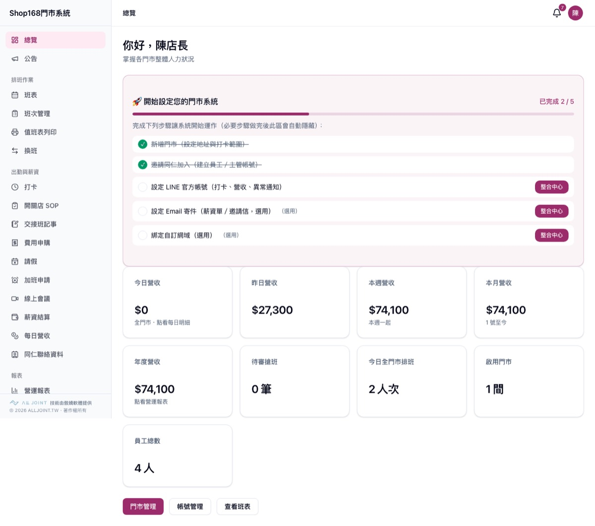
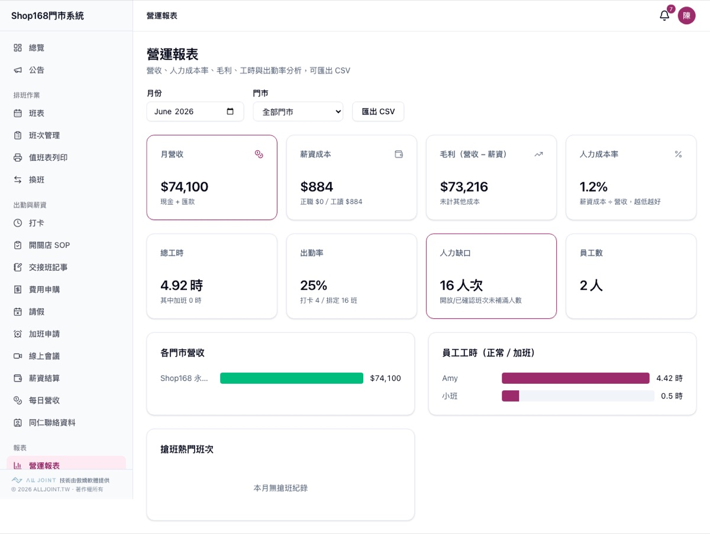
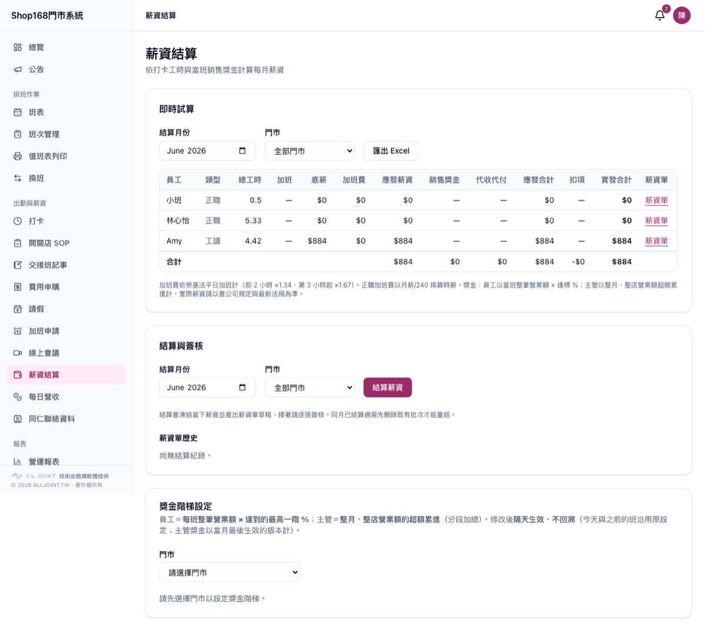
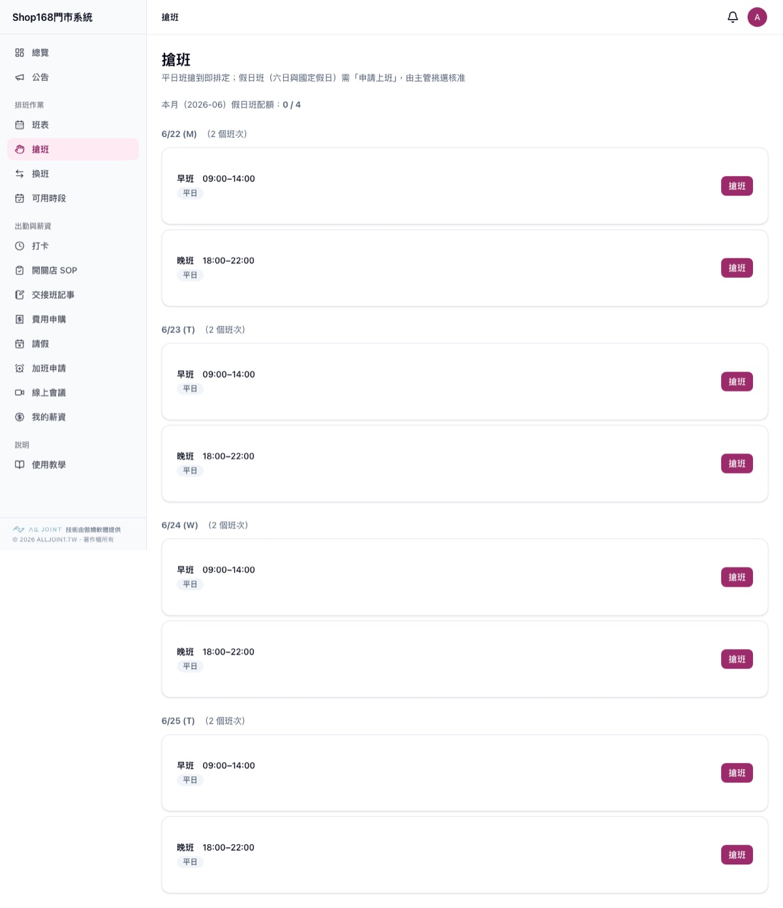
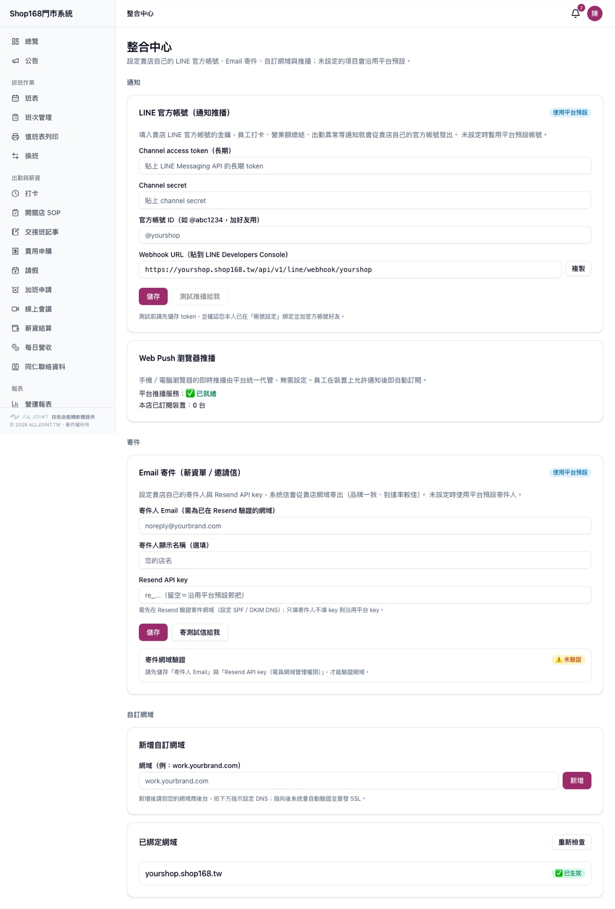

# 魏宇霆 David Wei

Founder of **BTF Culture & Creative (傲嬌文創)** and **Alljoint (傲嬌軟體)**, Taipei.

Founded Alljoint in 2016 and grew it to a team of 15 engineers at its peak,
building software for clients and our own products. Today I run it lean: over
the past year I built an AI-agent development workflow (Claude Code + Codex,
with Claude planning/reviewing and Codex implementing) and use it to ship and
operate several production SaaS products for Taiwanese SMBs, plus dozens of
internal tools that automate most of the company's day-to-day operations.

Most of my product code lives in private repos because it runs real businesses
with real customer data. This page is the public index.

## Live products

| Product | What it is | Stack |
|---|---|---|
| [work.btf.tw](https://work.btf.tw) | Shift scheduling + HR/payroll SaaS for retail and restaurant stores. Multi-store, 4 roles, claim-a-shift scheduling, clock-in, payroll with Taiwan labor/health insurance deductions, leave, expense claims, bonuses, daily revenue analytics, LINE push notifications. Used by real stores daily. | Next.js 15, TypeScript, Supabase (Postgres + RLS), Vercel |
| [quotation.alljoint.tw](https://quotation.alljoint.tw) | Quotation system with shareable per-quote links, PDF export and email delivery. | Vanilla JS, Supabase, Vercel |
| [ins.alljoint.tw](https://ins.alljoint.tw) | Mobile quiz app for Taiwan insurance-agent certification exams. | Single static HTML, Supabase (Google login + RLS) |
| [alljoint.tw](https://alljoint.tw) | Company site. | Next.js |

## Product tour: work.btf.tw

Screenshots from the demo tenant (test data). The product is a multi-tenant SaaS: each store brand gets its own tenant, and can bring its own LINE official account, email sender and custom domain.

**Owner dashboard**: onboarding checklist, revenue today/week/month, open shifts, headcount.

**Operations report**: revenue vs. payroll cost, labor-cost ratio, hours, attendance rate, staffing gaps, CSV export.

**Payroll**: monthly payroll computed from clock-in hours and per-shift sales bonuses, Taiwan overtime multipliers, payslip generation and sign-off, bonus tiers per store.

**Employee shift claiming**: staff claim weekday shifts instantly; weekend and holiday shifts go through manager approval with a monthly quota.

**Integration center (white-label)**: per-tenant LINE Messaging API credentials and webhook, web push, custom email sender via Resend, custom domain with automatic SSL.

## In progress

Several more vertical SaaS products for SMBs are in development (logistics and
compliance, membership and event management, hospitality, and an AI-assisted
financial research tool). Details on request.

## How I work

- Claude plans, Codex implements, both review each other's output. I read every diff.
- Security first: RLS with `WITH CHECK` on every update policy, `SECURITY DEFINER` RPCs for anonymous access, rate limits keyed by IP, no secrets in code. I keep a reusable RLS audit probe that runs as a PR gate.
- Every change is verified on a real environment (DB sandbox transactions, API smoke tests, Playwright screenshots), not just unit tests.

## Earlier

- **Lost & Found Lady (失物小姐)**: LoRa/Sigfox tracker tags for everyday items. Shut down after Apple AirTag launched.
- Early founding member of **Hackathon Taiwan**; mentored open-source and incubator teams.
- First business, in high school: automation bots for an online game, sold through forum word of mouth with a built-in referral feature (friend shares it, first month free).

## Contact

david@alljoint.tw
